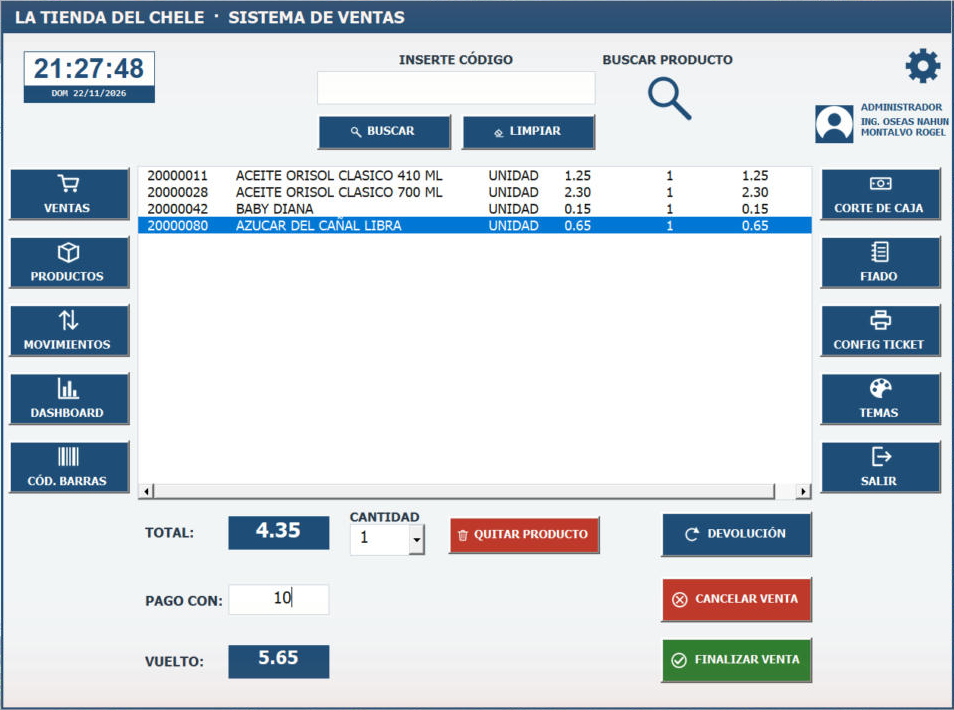
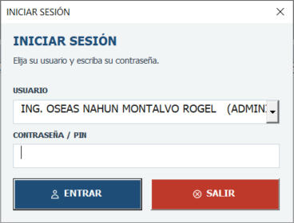
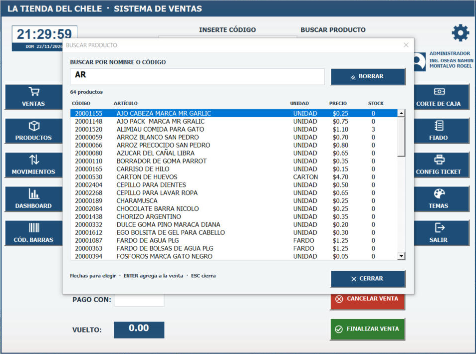
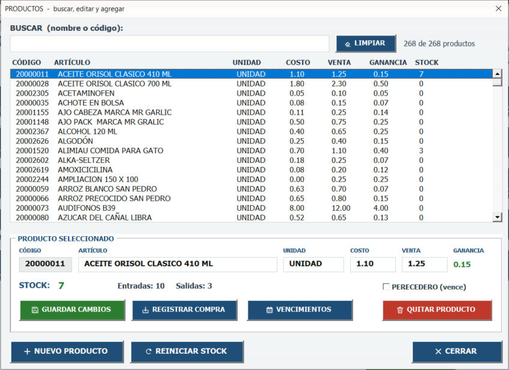
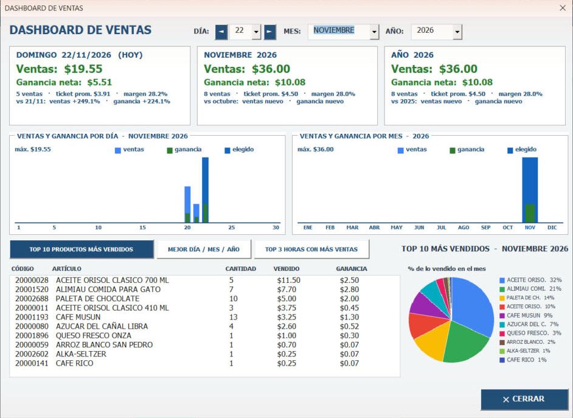
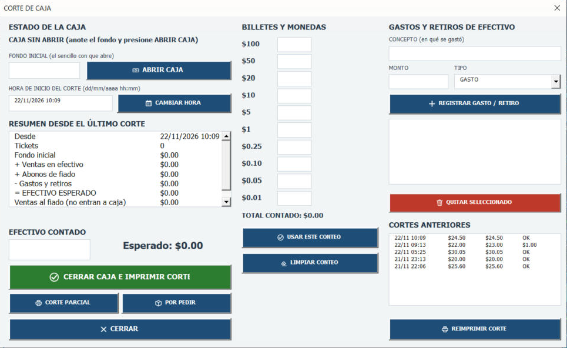
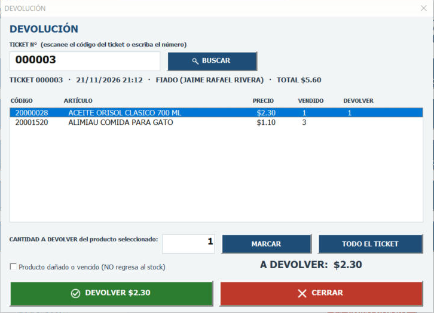

# 🛒 Sistema de Ventas para Tienda (POS en Excel + SQLite)


Sistema de punto de venta para tiendas, abarroterías y minisúper. Funciona en **Microsoft Excel para Windows** y guarda los datos en una base de datos **SQLite**, así que se mantiene rápido aunque tenga miles de ventas.

Se usa como una aplicación normal: al abrir el archivo, Excel queda oculto y aparece la caja. Se puede manejar **todo con el teclado** y con **lector de código de barras**.



---

## 📥 Descargar

1. Arriba en esta página, presione el botón verde **`<> Code`** → **Download ZIP**.
   (O descargue directo: [main.zip](../../archive/refs/heads/main.zip))
2. **Antes de descomprimir:** clic derecho en el ZIP → **Propiedades** → marque **Desbloquear** → **Aceptar**.
   Si no lo hace, Windows bloquea las macros porque el archivo viene de internet.
3. Descomprima la carpeta donde quiera (por ejemplo, en el Escritorio).

La carpeta ya trae todo lo necesario, **incluido el driver de SQLite**:

```
📁 Sistema de ventas
├── SISTEMA PARA TIENDA.xlsm     ← el sistema (ábralo para usarlo)
├── tienda.db                    ← la base de datos
├── 📁 drivers                   ← instaladores del driver SQLite ODBC (32 y 64 bits)
├── 📁 iconos                    ← iconos de los botones (no los borre)
└── LEEME - INSTALACION.txt
```

> ⚠️ No separe los archivos: `SISTEMA PARA TIENDA.xlsm`, `tienda.db` y la carpeta `iconos` tienen que estar juntos.

---

## 🔄 Actualizaciones

El sistema se actualiza solo desde este repositorio, **sin perder datos**:

1. Entre a **CONFIGURACIÓN** y presione **ACTUALIZAR**. El sistema solo se conecta a internet cuando usted presiona este botón.
2. Si hay una versión nueva, se muestran los cambios y se pide confirmar.
3. El sistema descarga la versión publicada en [Releases](../../releases/latest) y comprueba su **huella SHA-256**. Si el archivo no coincide, no se instala nada.
4. Antes de cambiar nada guarda un respaldo de `tienda.db` y del sistema actual en la carpeta `respaldos`.
5. Se cierra, se reemplaza el archivo del sistema y se vuelve a abrir solo.

Sus ventas, productos, clientes, usuarios y los datos del ticket se conservan: la base de datos `tienda.db` nunca se reemplaza. No se puede actualizar con una venta en curso.

> Si usted descargó el sistema antes de la versión **1.0.0**, descárguelo una vez más desde aquí (y copie su `tienda.db` en la carpeta nueva). Desde la 1.0.0 en adelante, las actualizaciones llegan con el botón **ACTUALIZAR**.

---

## ⚙️ Instalación (una sola vez por computadora)

### 1. Instalar el driver de SQLite

El sistema se conecta a la base de datos con el **SQLite3 ODBC Driver**. Los instaladores vienen en la carpeta `drivers`.

1. Abra Excel → **Archivo** → **Cuenta** → **Acerca de Excel** y vea si su Office es de **32 o 64 bits**.
2. Ejecute el instalador que corresponde:

   | Office | Instalador |
   |---|---|
   | 64 bits | `drivers\sqliteodbc_w64.exe` |
   | 32 bits | `drivers\sqliteodbc.exe` |

3. Acepte todo con **Siguiente → Instalar**.

> Si no está seguro de cuál es, instale los dos: no se estorban.

### 2. Habilitar las macros

- Abra `SISTEMA PARA TIENDA.xlsm`. Si Excel muestra la barra amarilla, presione **Habilitar contenido**.
- Si aparece la barra roja *"Microsoft bloqueó la ejecución de macros"*, cierre Excel, haga clic derecho en el archivo → **Propiedades** → **Desbloquear** → **Aceptar**, y vuelva a abrirlo.

### 3. Primera vez

Al abrirlo por primera vez, el sistema pide:

1. El **nombre de su tienda** (sale en la caja y en el ticket).
2. Crear el usuario **ADMINISTRADOR** con su contraseña. Guárdela bien: **no se puede recuperar**.

Después, en **CONFIGURACIÓN → USUARIOS**, puede crear a sus cajeros.

> La base de datos que viene incluida trae un catálogo de **268 productos de ejemplo** (con precios y stock en 0). Puede editarlos, borrarlos o empezar de cero con **CONFIGURACIÓN → REINICIAR SISTEMA**.

---

## 🧾 Cómo se usa

### Iniciar sesión

Cada persona entra con su usuario. Hay dos tipos:

- **ADMINISTRADOR:** puede todo (productos, precios, dashboard, configuración, usuarios).
- **CAJERO:** vende, cobra, hace cortes y devoluciones. Si toca una función de administrador, se le pide la contraseña de un administrador para autorizar.



Para cambiar de usuario o cerrar el sistema, presione **SALIR** en la caja: se abre la ventana de usuario. Si otra persona entra con su contraseña, sigue trabajando en la caja; si presiona **SALIR** otra vez, el sistema se cierra.

### Vender

1. Escanee el código de barras del producto o escríbalo en **INSERTE CÓDIGO**. El producto se agrega solo.
2. Para cambiar la cantidad, use **CANTIDAD** (F3).
3. Escriba con cuánto paga el cliente en **PAGO CON** (F2). El **VUELTO** se calcula solo.
4. Presione **FINALIZAR VENTA** (F9 o Enter en PAGO CON). Puede imprimir el ticket o no.

- Si no sabe el código, use la **lupa** (F1) y busque por nombre.
- Se puede vender un producto con stock 0: el sistema avisa, pero el stock **nunca queda negativo**.
- Al cobrar, si la caja todavía no está abierta, el sistema pide **abrir la caja** con el fondo inicial (el sencillo).



### Teclas rápidas

| Tecla | Acción |
|---|---|
| **F1** | Buscar producto por nombre |
| **F2** | Ir a PAGO CON |
| **F3** | Ir a CANTIDAD |
| **F4** | Quitar el producto seleccionado |
| **F5** | Vender al fiado |
| **F6** | Corte de caja |
| **F7** | Ver ventas |
| **F8** | Cancelar la venta |
| **F9** | Cobrar (finalizar venta) |
| **F11** | Cambiar de usuario |
| **F12** | Configuración |
| **Esc** | Volver a INSERTE CÓDIGO |

---

## ✨ Funciones

### 📦 Productos e inventario
- Buscar, editar y agregar productos. El **código lo da el sistema** (8 dígitos con verificador) y no se puede cambiar, para que ventas y registros nunca se descuadren.
- Costo, precio de venta y ganancia por producto.
- **Registrar compras** con proveedor y costo; el costo se recalcula con **promedio ponderado**.
- Productos **perecederos** con **lotes y fechas de vencimiento**. Al vender se descuenta primero el lote que vence antes. Ventana de **VENCIMIENTOS** con avisos de lo que vence pronto.
- Avisos de **stock bajo** y lista **POR PEDIR**.
- **Movimientos** (kardex): todas las entradas y salidas de cada producto.
- **Etiquetas con código de barras** para imprimir (se crean en Word con nombre y precio).



### 📊 Dashboard
Ventas y ganancia del día, del mes y del año, comparadas con el período anterior. Gráficas por día y por mes, **top 10 de productos más vendidos**, mejor día/mes/año y horas con más ventas.



### 💵 Corte de caja
- Apertura con fondo inicial.
- Resumen desde el último corte: ventas en efectivo, abonos de fiado, gastos y retiros, **efectivo esperado**.
- **Arqueo** contando billetes y monedas.
- Registro de **gastos y retiros** de efectivo.
- Corte parcial, cierre con impresión y lista de **cortes anteriores** (cuadra = OK, o la diferencia).



### ↩️ Devoluciones parciales
Escanee el código de barras de un ticket ya impreso (o escriba su número) y marque qué productos y cuántos regresan, sin anular toda la venta.
- El producto vuelve al stock (o no, si viene dañado o vencido).
- **Efectivo:** le dice cuánto entregar al cliente y la caja sigue cuadrando.
- **Fiado:** se descuenta de la cuenta del cliente.



### 📒 Fiado
Clientes con crédito, ventas al fiado, abonos, saldo de cada cliente y **estado de cuenta** imprimible.

### 🖨️ Ticket
Ticket configurable: nombre del negocio, dirección, teléfono, WhatsApp, correo, logo, código QR, texto de promoción y **código de barras del número de ticket** (para las devoluciones). Funciona con impresora normal o térmica.

### 🎨 Temas y configuración
- Varios **temas de colores**; todos los botones e iconos cambian con el tema.
- Modo **pantalla completa**.
- **Respaldo automático** diario de la base de datos (carpeta `respaldos`).
- **Reiniciar sistema** (solo administrador): deja todo como recién instalado, con opción de conservar los productos.
- **Actualizar**: busca e instala la última versión publicada en este repositorio, con respaldo previo.
- **Copia para vender**: crea una carpeta lista para entregar a otro negocio, sin sus ventas ni usuarios.
- Todo el texto en **MAYÚSCULAS** y números con **punto decimal**.
- Contraseñas guardadas cifradas (**SHA-256** con sal).

---

## 🧰 Requisitos

- Windows 10 u 11.
- Microsoft Excel de escritorio (Microsoft 365, 2021, 2019 o 2016), de 32 o 64 bits, con macros habilitadas.
- SQLite3 ODBC Driver (incluido en la carpeta `drivers`).

## 🏗️ Cómo está hecho

- **Interfaz:** formularios de VBA (UserForms) en Excel. La ventana de Excel se oculta y solo se ve el sistema.
- **Datos:** SQLite (`tienda.db`) mediante ODBC + ADODB. Ventas con cabecera y detalle, kardex de movimientos, compras por lote, fiado, cortes de caja, devoluciones y usuarios.
- **Iconos:** máscaras en la carpeta `iconos` que el sistema pinta con los colores de cada tema.

## ❓ Problemas comunes

| Problema | Solución |
|---|---|
| Al abrir sale un error de **base de datos** o de **driver** | Instale el driver de la carpeta `drivers` que corresponde a su Office (32 o 64 bits). |
| Las macros no se activan | Desbloquee el archivo (clic derecho → Propiedades → Desbloquear) y presione *Habilitar contenido*. |
| No aparecen los iconos de los botones | Verifique que la carpeta `iconos` esté junto al archivo `.xlsm`. |
| Olvidé la contraseña del administrador | No se puede recuperar. Si hay otro administrador, puede cambiarla en CONFIGURACIÓN → USUARIOS. |

---

Hecho en El Salvador 🇸🇻
